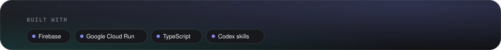

<a href="https://canessasyslabs.com/omniscribe/"><b>See it on canessasyslabs.com&nbsp;&nbsp;→</b></a>

OmniScribe has two parts. A skill-driven production workflow rebuilds a chapter from course sources, closes knowledge gaps using authoritative references, applies cognitive-learning principles and produces an HTML study guide. A web platform then publishes approved guides as responsive, print-ready documents in a Course → Week library with full-content search.

© Canessa System Labs. All rights reserved. This repository presents the work; it does not license it. No part of its text, images or design may be reused without written permission.

